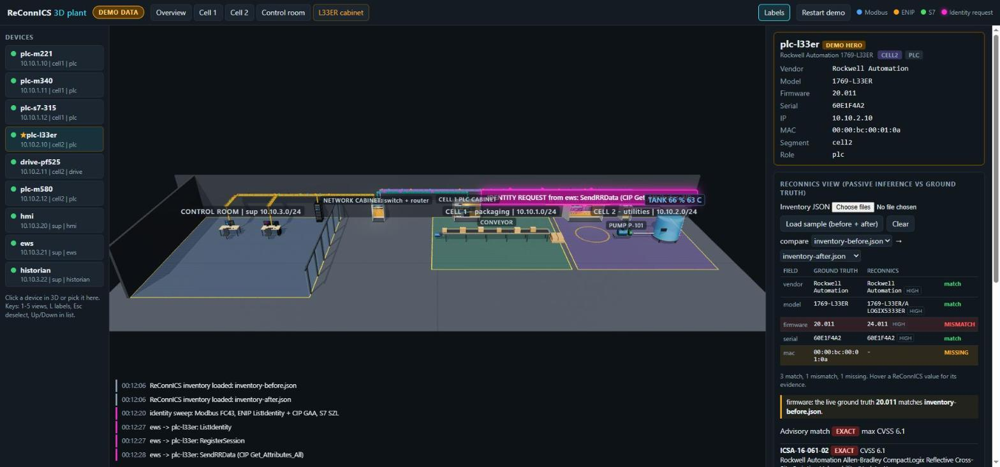

# 3D plant viewer

Browser viewer for the netns plant (`plant/`): a procedural plant floor bound to the plant's state feed, with a
side-by-side of what ReConnICS-ng inferred versus the plant's ground truth. Static files, no build step. Three.js
0.160.0 is loaded from jsdelivr via an import map (internet needed on first load; vendor it if the lab is offline).



## Run

```sh
cd viewer && python -m http.server 8123      # then open http://localhost:8123/
```

| Mode | How | Badge |
|---|---|---|
| auto (default) | tries `ws://localhost:8765/state` for 2.5 s, falls back to the built-in simulator, retries live every 6 s | LIVE / DEMO DATA |
| live | `?mode=live` (optionally `&ws=ws://host:port/state`); waits and retries if the feed is down | LIVE |
| plant replay | start `python plant/feed.py --replay plant/demo-run.jsonl.gz --loop` (stdlib, any OS) and open the viewer normally; frames carry `replay: true` | REPLAY (plant feed.py) |
| file replay | `?replay=sample/demo-run.jsonl.gz` plays a recording client-side (JSON array, NDJSON or `.gz`, honours `t`, loops) | REPLAY |
| demo | `?mode=demo`; built-in simulator, same schema | DEMO DATA |

Live plant: `.\plant\demo.ps1` (WSL2) or `sh plant/run.sh --feed`. `sample/demo-run.jsonl.gz` is a copy of the committed
`plant/demo-run.jsonl.gz` (lab commit 4137997/c213a25).

Other URL params: `?inventory=a.json,b.json` (ReConnICS-ng inventories), `?changes=log.json`, `?view=overview|cell1|cell2|control|hero`,
`?select=10.10.2.10`.

## Storyline (feed `events`, same in the demo simulator)

boot + gratuitous ARP (t=4) -> HMI polling -> **EWS identity sweep (t=15)** -> **L33ER firmware flash 20.011 -> 24.011
(t=40, offline ~7 s)** -> **second sweep (t=65)** -> loop at 90 s.

- **Hero: Rockwell 1769-L33ER (10.10.2.10)**, the most detailed cabinet: PSU, controller with LED set, asset-tag plate (model / FW /
  serial), four I/O modules whose channel LEDs follow the tank (pump, low/high level), M580 rack, terminal blocks, relays, breakers,
  wiring harness, beacon (green run / amber flash / blue sweep), floor marker. Key `5` / "L33ER cabinet" flies to it.
- **Identity sweep visual**: identity requests (everything the EWS initiates, plus FC43 / ENIP ListIdentity from clients) are
  magenta, larger, haloed and slower than normal traffic. When one reaches a device a ring pulses there; at the L33ER you also get a
  magenta scan beam through the cabinet, a callout naming the request, the blue beacon, and an event line. The EWS monitor scrolls the probes.
- **Firmware change**: during the flash the controller LEDs go red/amber and the plate shows FLASHING; when it returns the plate turns
  amber with `FW 24.011 CHANGED`, a banner floats over the cabinet, the identity card tags it `changed` and keeps a history.

## Identity card and ReConnICS view

Click a device in 3D or use the keyboard-focusable list (Up/Down, Enter). The card shows vendor, model, firmware, serial, IP, MAC,
segment, role and live process state. Below it, "ReConnICS view":

- Load inventories with the file picker (several files at once) or `?inventory=`. Accepted: `reconnics-ng inventory` output
  (`schema:1`), `analyze` output, the `/api/v1/inventory` wrapper, and a change log array (`/api/v1/changes` shape `{at, asset, field, from, to}`).
- Table per field: ground truth | inferred value + confidence (evidence on hover) | match / MISMATCH / MISSING / no ground truth; advisory
  match level and advisories; completeness and the tool's hints (e.g. why MAC is missing on the core tap).
- Two inventories: pick earlier -> later; the panel lists what changed for that device (firmware, advisory level, advisories). If the live
  feed changed a field the inventory disagrees with, it says "stale inventory" and shows the pre-change value; with several inventories it
  says which of them match the live truth. A loaded change log is shown as "ReConnICS change history".
- `sample/inventory-before.json` / `inventory-after.json` are real `reconnics-ng` runs over the plant's `captures/plant/sup-before.pcap` /
  `sup-after.pcap` (index signature **not** verified; the lab has no public key). "Load sample" loads them. `sample/changes.json` is
  hand-written (ng does not emit a change history for capture-driven changes yet) and is not loaded by default.

## Verify

```sh
node viewer/test/inventory.test.mjs          # parse / compare / diff against the sample inventories
```
Rendering: open the page, check the DevTools console is empty, step through the five camera presets.

## Screenshots

Chrome DevTools: Ctrl+Shift+P -> "Capture screenshot" (viewport) at 1568x733 or similar. The canvas uses `preserveDrawingBuffer`, so
`viewer.canvas.toDataURL('image/png')` in the console also works. For a repeatable shot: `?mode=demo&view=hero&select=10.10.2.10&inventory=sample/inventory-before.json,sample/inventory-after.json`
and wait ~50 s for the firmware change. Committed examples in `docs/`.

## Files

`index.html`, `style.css`; `js/main.js` (wiring, events, selection), `feed.js` (live/replay/demo sources), `schema.js` (STATE_FEED.md
adapter, identity detection), `demo.js` (simulator), `scene.js` (renderer, packets, LEDs, picking), `plant3d.js` + `cabinets.js` +
`parts.js` (procedural geometry), `inventory.js` (parse/compare/diff, DOM-free), `ui.js` (panels).

## Limitations / next steps

- Conformance to STATE_FEED.md is done for `devices`, `flows`, `events` (drives the event strip, keyed by `(t, kind, device)`) and device
  `state`; `segments` is read but not used. Flows from `router` are routed to the network cabinet; raw-IP endpoints are resolved by IP.
- Process binding: `level_pct`, `pump_rpm`, `speed_pct`, `temp_c`; the first device carrying a value wins (L33ER first). Unit assignments in the feed
  (e.g. PF525 = conveyor) do not match the 3D layout (PF525 drives the pump); the VFD display follows `pump_rpm`.
- The 3D layout is static and keyed by the plant's IPs; devices added to `plant/devices/` appear in the list but not in 3D.
- Three.js comes from a CDN; picking ignores doors (clicks go through); no automated browser test.
